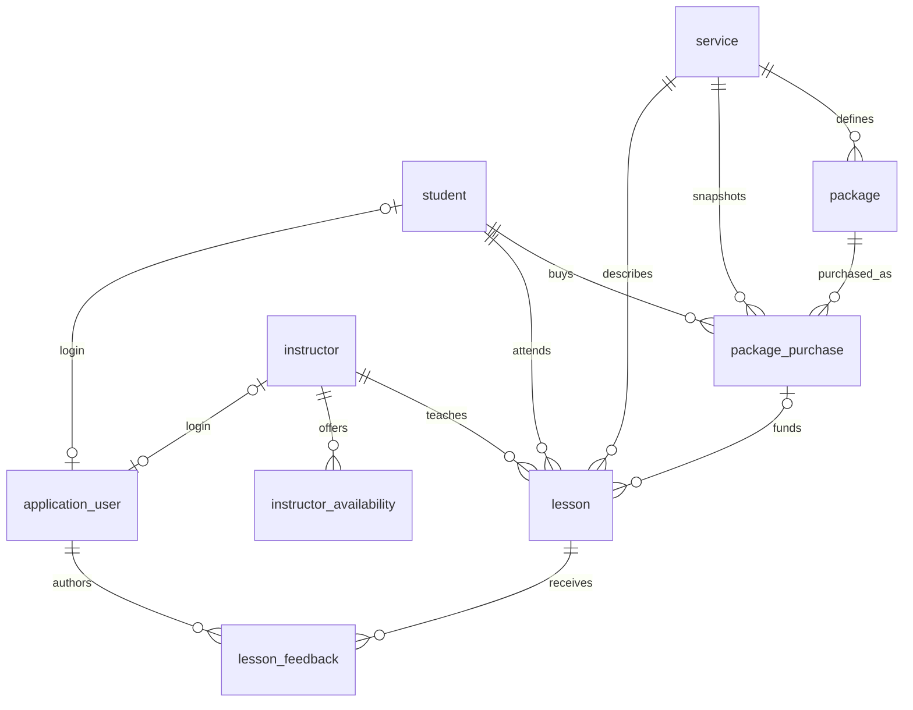

# LAC database — first draft

This draft implements the nine core tables in the supplied Technical Design
Document and proposal. Names use PostgreSQL-style `snake_case`: `Student` becomes
`student`, and `studentID` becomes `student_id`.

## Files and execution order

1. `schema.sql`: creates the tables, rules, indexes and six reporting views.
2. `seed.sql`: optional fictional demonstration records. Never run on real client data.
3. `queries.sql`: example read-only reports.
4. `tests.sql`: checks the seeded demonstration database; rolls its changes back.

In Neon SQL Editor or pgAdmin Query Tool, open each file and run its contents in
that order against a **new, empty development database**. This does not connect to
Neon automatically, create a Neon project, or change the app's API.

With PostgreSQL command-line tools, an alternative is:

```sh
psql "$DATABASE_URL" -v ON_ERROR_STOP=1 -f database/schema.sql
psql "$DATABASE_URL" -v ON_ERROR_STOP=1 -f database/seed.sql
psql "$DATABASE_URL" -v ON_ERROR_STOP=1 -f database/tests.sql
psql "$DATABASE_URL" -v ON_ERROR_STOP=1 -f database/queries.sql
```

These are one-time initialization scripts, not repeatable migrations. Rerunning
the schema fails rather than deleting existing records. Future changes should
be separate, reviewed migration files. `btree_gist` must be available and the
setup account must be allowed to create that extension.

## How the tables connect



Primary keys identify records. Foreign keys connect them. For example,
`lesson.student_id` identifies the student attending that lesson.

## Provisional rules — confirm with the client

- A lesson has one student and one instructor. Group classes are not modeled.
- Completed and no-show package lessons consume entitlement. Scheduled lessons
  reserve it; cancelled lessons release it. Confirm the no-show/cancellation rules.
- Six purchased, two completed, one scheduled gives four remaining, one reserved,
  and three unallocated. Remaining does not necessarily mean usable: check the
  purchase status and expiry too. Past lessons still marked scheduled continue
  to reserve entitlement until staff correct their status.
- Package purchase terms are immutable snapshots, including service and price.
  The API copies service, allowance and price from the selected package at sale.
  It must validate the agreed terms; SQL accepts explicit snapshot values.
- Expiry is optional and inclusive in Vancouver local time. The API should set
  the client-approved expiry (provisionally 12 months), rather than relying on an
  automatic default. Package-funded lesson dates must be within purchase dates.
- No-shows and completed lessons retain their time slots for historical integrity.
  Cancelled lessons release their slots. Back-to-back lessons are permitted;
  travel buffers are not yet modeled.
- Money is CAD, stored as exact decimal amounts. No tax/payment accounting is
  included. Email is required but shared contact emails are permitted.
- Users have one role: admin, instructor, or student. Driver is provisionally
  treated as instructor. Student login remains subject to scope confirmation.
- Feedback defaults to instructor-only. The API decides who may author/read it.

## Integrity and API responsibilities

SQL enforces valid references, positive durations/allowances, nonnegative prices,
valid statuses, matching purchase/student/service, package capacity, and no
overlapping student or instructor lessons. Foreign keys restrict deletion of
referenced history; normal workflows should cancel/deactivate records.

`entitlement_slot` is an internal numbered unit of a package. The lesson trigger
assigns it automatically; callers should omit it. Unique slots bound reservations
plus consumed lessons to the purchased allowance, including concurrent writes.
The trigger locks the purchase during allocation. The API must retry a whole
transaction on serialization failures, deadlocks, or slot uniqueness conflicts.
Use PostgreSQL's default READ COMMITTED isolation or SERIALIZABLE with retries.

Scheduling checks still belong in the API: active users/services, instructor
availability, lesson duration for its service, approved pickup points, and
cancellation cutoffs/admin approval. Availability rows are informational; SQL
does not require every historical lesson to fit a current availability window.
Keep related changes in one transaction. When cancelling a purchase, first
cancel its scheduled lessons. Lock the purchase before related multi-step edits.

Authentication and record-level permissions are **not implemented by these SQL
files**. Reports include all users' records. Only the trusted backend should have
database credentials; it must derive identity from authentication and filter
every query, including feedback visibility. No passwords are stored here.

Payments, approval requests, group attendance, practice-test scores, vehicles,
and a separate approved-pickup-location table need additional agreed design.
This is a core database draft, not the full expanded UI feature set.

The seed uses fixed 2026/2027 dates so the balance example stays reproducible;
upcoming/follow-up results depend on the date the queries are run.

## Validation performed

All four SQL files execute successfully in a temporary PGlite PostgreSQL runtime
with `btree_gist`. Smoke tests cover the six-lesson balance example, instructor
overlap rejection, purchase ownership, capacity limits, cancellation releasing a
unit, rebooking that unit, and immutable purchase terms. Tests roll back their
edits. Neon deployment, API integration, and simultaneous connections still need
integration testing; the local runtime check is not a concurrency test.

PostgreSQL references: [range/exclusion constraints](https://www.postgresql.org/docs/current/rangetypes.html#RANGETYPES-CONSTRAINT)
and [locking](https://www.postgresql.org/docs/current/explicit-locking.html).
